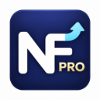

# NameFirst Pro



**名前を起点に、検索時の証拠で確認する。** NameFirst Pro はデスクトップ版 Chrome／Edge 向けの独立したオープンソース拡張機能です。Bing／Baidu で公式の入口を探しているかを判断し、既存の一覧にない名前も候補を発見します。許可を得たうえで、その場で公開情報を取得して帰属を確認します。ライセンスは **AGPL-3.0-only** で、条件を守った商用利用も可能です。

[简体中文](./README.md) · [繁體中文](./README.zh-TW.md) · [English](./README.en.md) · [日本語](./README.ja.md) · [한국어](./README.ko.md) · [Français](./README.fr.md) · [Deutsch](./README.de.md) · [Español](./README.es.md) · [Português](./README.pt-BR.md)

**初版は `1.0.0` で、青いブランドは承認済みです。** [公式 Releases](https://github.com/Thicky-han/namefirst-pro/releases)から入手してください。`v1.0.0` がまだなければ、管理者の最終公開確認待ちで、配布パッケージは未公開です。ソース ZIP はそのままインストールできません。**画面は現在、簡体字中国語のみ**です。9 言語の README は 9 言語の UI を意味しません。

## 主な機能

- 対応する検索のたびに、入口の検索・情報検索・不確実をローカルで推定します。名前の事前登録は不要です。
- 入口を探す処理では制限された予算内で現在の候補と証拠を集め、正確な URL、用途、出典、時刻、状態を表示します。証拠が不十分なら判断を保留します。
- 元の検索結果を残し、自動移動・ダウンロード・ファイル実行はしません。
- 明示的なフィードバックだけでローカルの意図モデルを学習します。個人用 URL・別名・除外と公式の帰属判断は別です。
- 編集・削除・直前の変更の取り消し、JSON のプレビュー付き統合／置換、Chrome／Edge 間の手動移行に対応します。

## ダウンロードとインストール

完成 ZIP の利用に Node.js、アカウント、API キー、プロジェクト用サーバーやコンパイルは不要です。

1. [Releases](https://github.com/Thicky-han/namefirst-pro/releases) で正式版 `v1.0.0` を開きます。Chrome は `namefirst-pro-1.0.0-chrome.zip`、Edge は `namefirst-pro-1.0.0-edge.zip` を選びます。`namefirst-pro-1.0.0-source.zip` は対応するソース一式です。
2. ZIP の**全ファイル**を、今後も保存するフォルダーに展開します。ZIP の中から読み込まず、読み込み後にフォルダーを削除しないでください。
3. `chrome://extensions` または `edge://extensions` を開き、デベロッパーモードを有効にして「パッケージ化されていない拡張機能を読み込む」を選びます。
4. **`manifest.json` を直接含むフォルダー**を指定します。外側のフォルダーではありません。**NameFirst Pro** が読み込まれたことを確認し、必要なら青い NF／PRO アイコンをツールバーに固定します。
5. 拡張機能のポップアップで全体と使用する検索エンジンのスイッチを有効にします。外部の証拠を取得するには「开启联网核验权限」を押し、HTTPS サイトへのアクセスを求めるブラウザーの説明を読んで許可します。許可は撤回でき、未許可では外部証拠を取得しません。
6. 通常のデスクトップ版 Bing／Baidu で `Apache Arrow official website` を検索します。カードの**現在の状態、正確な入口、出典、時刻**を確認してください。方針を満たす今回の証拠がある場合のみ公式帰属を支持します。未知の名前も発見処理に入れますが、認証できる保証はありません。

詳しくは[英語のインストール手順](./INSTALL.en.md)または[簡体字中国語の手順](./INSTALL.md)をご覧ください。

## フィードバック、バックアップ、更新

情報収集なのに入口の検索と判断された場合は「这次查资料」を選びます。「我在找入口」は入口を探す意図を伝えます。「仅本次按入口核验」は今回だけの確認で、学習ラベルを保存しません。スキップやクリックしないことからは学習しません。学習と質問表示は個別に無効化でき、個人用 URL は未認証として区別されます。

「管理记录、查看历史证据与备份迁移」から管理画面を開き、「导出 JSON 备份」で保存します。新しいブラウザーではファイルを選び、統合／置換を選択して「预览导入」で確認してから確定してください。統合では競合するローカル記録を残し、置換では個人・学習データを上書きします。権限、設定、過去の証拠、取り消し履歴は移行されません。不明・破損した形式で既存データを上書きしません。バックアップには自分で入力した名前や URL が含まれるため、安全に保管してください。

更新前にバックアップし、新版をすべて展開して読み込み先のファイルを置き換えます。拡張機能の管理画面で再読み込みし、検索タブも更新してください。ディスク上の置き換えだけでは古いバックグラウンド処理が残ることがあります。**先にアンインストールしないでください**。ローカルデータが消えます。同じ拡張機能 ID とプロファイルなら通常はデータを保持しますが、すべての将来形式の互換性は保証しません。

カードが出ない場合は対応 URL／画面構成、全体・エンジンのスイッチ、更新後のタブ再読み込みを確認します。証拠を取得できなければ外部アクセス権限、ネットワーク、表示理由を確認します。CAPTCHA、ログイン、制限、タイムアウトでは停止または保留し、回避しません。エンジンの一時停止や権限の撤回もできます。[管理の詳細](./MANAGEMENT.md)。

## 対応範囲とプライバシー

現時点で肯定的な公式帰属を判断できる唯一の権威方針は、Apache が管理するプロジェクト一覧で明示された**ホームページ／ダウンロード入口**です。Wikidata は手掛かりに限ります。順位、HTTPS、自己申告、モデルのスコア、個人の選択だけでは証明になりません。一般的な文書／ログイン入口の方針、全 Web の認証、ソフトウェアの安全性・法的資格の保証はありません。

対応するのは認識可能なデスクトップ版 Bing の HTTPS `/search`（`www.bing.com`、`cn.bing.com`、`bing.com`）と `www.baidu.com/s` の UTF-8 通常 Web 検索です。モバイル、画像／ニュース検索、隠れた・未知の画面構成は対象外です。管理者の指示により通常の実環境オンライン受け入れ確認は今回の段階条件から外しており、制御されたブラウザーテストと過去のオンライン記録を分けて報告しています。

テレメトリー、リモート学習、自動フィードバック送信はなく、完全な検索履歴も保存しません。明示ラベルと個人記録はローカル保存です。許可後にアクセスするサイトには IP や要求 URL が見える可能性があり、追加探索では検索エンジンに関連する名前を送ることがあります。完全オフラインや匿名通信ではありません。過去の証拠は常にキャッシュ表示で、再取得に失敗しても確認時刻を更新しません。今回の入口検索では現在の証拠を収集します。[プライバシー](./PRIVACY.md)・[学習の説明](./LEARNING.md)。

[公開評価](./EVALUATION.md)：実在するソフトウェア名で手作成した 36 件の検索では、既存の学習済みモデルは 25 件正解、6 件保留、情報検索 5 件を入口検索と誤判断しました。合成した信頼テスト 24 件では期待状態が 23 件一致し、3 件の認証に誤認証はありません。文書入口の 1 件は安全に保留しましたが、機能目標には未達です。実利用者の標本や Web 全体の精度推定ではありません。

## 開発とライセンス

開発には Node.js 24+ と pnpm 11.25.0 が必要です。

```powershell
pnpm install --frozen-lockfile
pnpm check
pnpm test
pnpm evaluate:release
pnpm build
```

配布準備には Git と Python 3.9+、`pnpm release:prepare`、`pnpm release:verify` も使います。配布の `SHA256SUMS` と `Get-FileHash -Algorithm SHA256 <ファイル名>` で照合できます。一致は安全性の保証ではありません。

実装と Git 履歴は独立しています。管理者の許可で元の NF／矢印を洗練した青い Pro 派生図案は承認済みです。独自コードとこの派生図案は AGPL-3.0-only、依存物はそれぞれのライセンスです。[図案の来歴](./assets/brand/README.md)・[依存物](./DEPENDENCIES.md)・[LICENSE](./LICENSE)・[リリースノート](./RELEASE_NOTES.md)・[貢献方法](./CONTRIBUTING.md)。
